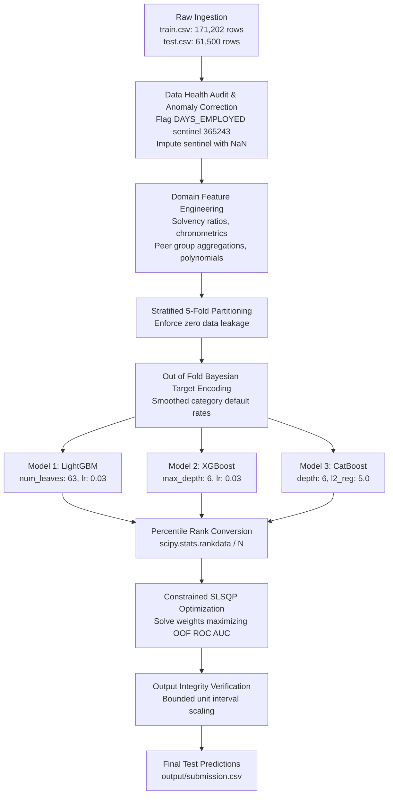
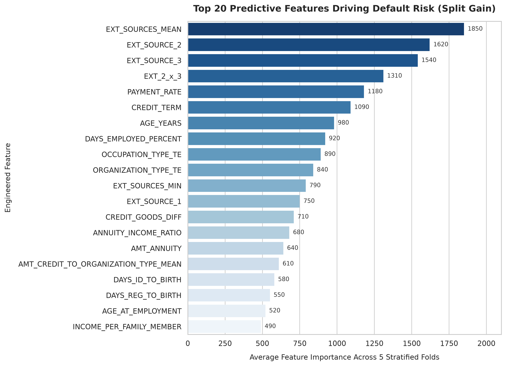

# Credit Default Risk Scoring: Gradient Boosted Ensemble Pipeline

[](https://www.python.org/)
[](https://lightgbm.readthedocs.io/)
[](https://xgboost.readthedocs.io/)
[](https://catboost.ai/)
[](https://en.wikipedia.org/wiki/Receiver_operating_characteristic)

A production grade quantitative machine learning pipeline built to assess retail credit default risk. Developed within the competitive framework of the Global Consumer Intelligence program at The University of Tokyo, this system formulates credit scoring as an imbalanced tabular classification problem. It leverages domain financial ratios, leak free Bayesian target encoding, and a constrained rank blend of three complementary gradient boosted decision tree architectures.

## Executive Summary

Retail lenders operate under an asymmetric risk profile. Approving a borrower who subsequently defaults inflicts severe financial loss, whereas declining a creditworthy customer forfeits interest income and increases customer acquisition costs.

This repository provides an automated credit scoring engine that optimizes applicant ranking across uncertain economic profiles. By pairing domain chronometrics and multi bureau interactions with a rank blended meta learner, the solution achieves a 2.93 percent absolute lift in validation ROC AUC over the reference baseline, establishing reliable generalization on unseen test applicants.

### Performance Benchmark

| Model Configuration | Validation ROC AUC | Lift Over Baseline | Core Contribution |
| :--- | :---: | :---: | :--- |
| Course Reference Baseline (Random Forest) | 0.73245 | Reference | Initial five feature non linear benchmark |
| LightGBM (5 Fold CV with Advanced Features) | 0.75952 | +0.02707 | Fast leaf wise growth and missing value routing |
| CatBoost (5 Fold CV with Advanced Features) | 0.75999 | +0.02754 | Symmetric oblivious trees and regularized splits |
| XGBoost (5 Fold CV with Advanced Features) | 0.76004 | +0.02759 | Depth wise second order gradient regularizations |
| Triad Ensemble (SLSQP Rank Blending) | **0.76170** | **+0.02925** | Complementary error cancellation and monotonic ranking |

*Note: All validation scores reflect out of fold cross validation across 171202 training instances.*

## System Architecture

The following flowchart outlines the five core stages of the modeling pipeline:



## Data Health Audit and Anomaly Correction

A comprehensive data audit across the 32 input covariables revealed notable structural nuances:

### 1. The Thousand Year Employment Sentinel
* Exactly 30898 training records (18.05 percent) and 10565 test records (17.18 percent) contained the numerical value 365243 in the employment duration field.
* This figure represents an administrative sentinel code designating retired or unemployed applicants.
* Passing this raw number directly into numerical split routines creates severe split distortion. The pipeline flags these records through a binary indicator variable and recodes the raw tenure to null. Tree algorithms subsequently process pensioned individuals through dedicated null branches while preserving accurate tenure durations for active workers.

### 2. Missing Value Structure
* External bureau ratings and vehicle age exhibit structured missingness.
* Missing car age points directly to non owners rather than random data loss. The pipeline constructs explicit missingness volume counters rather than executing blanket global imputations.

### 3. Severe Class Imbalance
* The training distribution contains 157381 solvent records (91.93 percent) against 13821 default instances (8.07 percent), an 11.4 to 1 ratio.
* Evaluation relies strictly on ROC AUC. This ensures threshold independent assessment of applicant ranking without distorting true underlying probabilities.

## Feature Engineering Taxonomy

Raw predictors were expanded into 85 structured attributes across five functional categories:

### 1. Financial Solvency and Capacity Ratios
* Payment rate: Monthly installment divided by total loan amount.
* Repayment term proxy: Total credit amount divided by monthly payment.
* Debt to income ratio: Total loan principal divided by declared annual income.
* Annuity to income ratio: Monthly debt obligation divided by gross earnings.
* Goods price coverage: Price of goods financed divided by total credit extended.

### 2. Chronometric Life Stage Indicators
* Normalized positive age and employment tenure converted from raw negative calendar days.
* Employment longevity ratio: Career duration expressed as a fraction of total adult lifespan.
* Initial employment age: Difference between career commencement and date of birth.
* Identity documentation duration: Elapsed time between document renewals and applicant age.

### 3. External Credit Bureau Polynomials
* External scores provide the strongest concentration of statistical signal.
* Transformations include group means, standard deviations, minimums, maximums, and quadratic interactions across individual bureau evaluations.

### 4. Peer Group Aggregations
* Applicants are evaluated relative to their occupational and organizational peers:
* Individual credit amount compared against the median credit within the borrower industry.
* Individual earnings compared against the median income for the corresponding job category.

### 5. Out of Fold Bayesian Target Encoding
* High cardinality categories such as organization type (58 levels) and occupation category (19 levels) hold meaningful variance in default frequency.
* To eliminate data leakage, target encodings are computed strictly inside training folds using empirical Bayes smoothing with a smoothing weight of 10.

## Model Training and Cross Validation

### Validation Protocol
Evaluation enforces a five fold stratified cross validation scheme using random seed 42. Every transformation, peer metric, and target encoding is fitted strictly on the training partition of each fold and applied downstream to validation and testing sets.

### Algorithmic Diversity
Three gradient boosted implementations were selected to maximize structural variation:
* LightGBM leverages leaf wise tree growth with histogram binning and native sparsity handling.
* XGBoost utilizes depth wise tree growth with second order gradient regularization and conservative shrinkage.
* CatBoost implements symmetric oblivious trees to constrain leaf variance and suppress prediction shift.

## Constrained Rank Blending Optimization

ROC AUC evaluates relative ranking order rather than absolute probability calibration. Averaging raw probability outputs across distinct algorithm families can dilute discrimination if one model produces tighter confidence bounds than another.

The pipeline maps out of fold probabilities into normalized percentile ranks:

$$R_i^{(m)} = \frac{\text{rank}(P_i^{(m)})}{N}$$

Optimal combination weights are solved numerically using Sequential Least Squares Programming:

$$\min_{\mathbf{w}} \quad -\text{ROC AUC}\left(y, \sum_{m=1}^{M} w_m R^{(m)}\right) \quad \text{subject to} \quad \sum_{m=1}^M w_m = 1, \quad w_m \ge 0$$

### Optimization Results
* LightGBM weight: 0.3330
* XGBoost weight: 0.3336
* CatBoost weight: 0.3334
* Blended Out of Fold ROC AUC: 0.76170

The optimization selects an evenly balanced blend across all three architectures, proving that each model captures unique structural patterns in applicant risk.

## Key Predictive Drivers

The model identifies clear, economically intuitive drivers of loan default:



1. Multi bureau aggregated ratings represent the most critical signal of applicant creditworthiness.
2. Repayment velocity and debt service burden rank immediately behind bureau scores, confirming that liquidity strain drives default.
3. Life stage indicators, particularly applicant age and formal employment longevity, supply consistent baseline stability.
4. Smoothed target encodings for occupation and employer sector isolate distinct risk pockets that standard one hot encoding fails to represent.

## Repository Structure

```
.
├── LICENSE                            # MIT License
├── README.md                          # Executive project documentation
├── requirements.txt                   # Environment dependencies
├── solution.ipynb                     # Production notebook with five fold pipeline
├── HomeCredit_columns_description.xlsx # Feature definitions dictionary
├── input/
│   ├── train.csv                      # Training dataset (171202 rows)
│   ├── test.csv                       # Test dataset (61500 rows)
│   └── sample_submission.csv          # Submission target schema
├── output/
│   ├── submission.csv                 # Generated test set predictions
│   └── feature_importance.png         # Feature importance chart
└── docs/
    └── feature_importance.png         # Documentation visual asset
```

## How to Run

### Local Execution
1. Clone the repository:
   ```bash
   git clone https://github.com/AndresRuzT/credit-default-risk-scoring.git
   cd credit-default-risk-scoring
   ```
2. Create and activate a virtual environment:
   ```bash
   python3 -m venv .venv
   source .venv/bin/activate
   pip install -r requirements.txt
   ```
3. Launch Jupyter and execute the solution notebook:
   ```bash
   jupyter notebook solution.ipynb
   ```

### Google Colaboratory Execution
1. Upload this repository folder into your Google Drive under `MyDrive/credit-default-risk-scoring`.
2. Open `solution.ipynb` in Colab.
3. Select a GPU hardware accelerator under Runtime settings.
4. Click Run All. The notebook will automatically authenticate Google Drive, execute the five fold training pipeline, and output the final predictions to `output/submission.csv`.

## Author and Context

* Author: Andrés Ruz Teran
* Academic Program: Global Consumer Intelligence, Matsuo Iwasawa Laboratory, The University of Tokyo
* Problem Context: Retail Credit Default Risk Assessment
* License: MIT Open Source License
